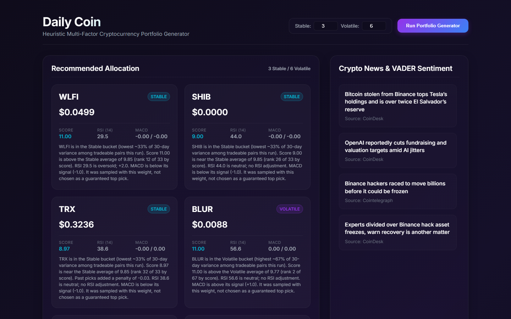
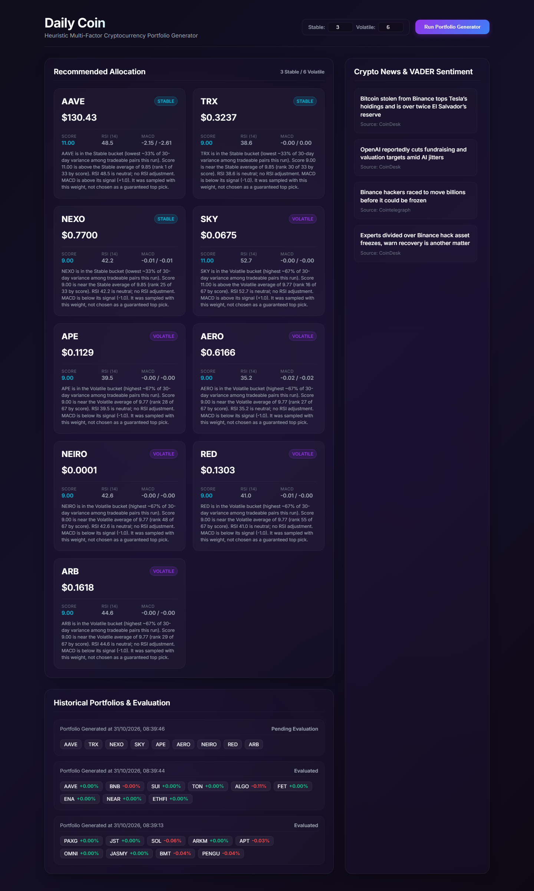

# Daily Coin

A Python CLI and web dashboard that generate a cryptocurrency portfolio of 9 coins by default (6 volatile, 3 stable) and learns from past performance.

## Features
- **Heuristic Feedback Loop**: Learns from previous portfolio performance. Coins that gain value are rewarded; coins that lose value are penalized in future selections.
- **News Sentiment Analysis**: Pulls the latest crypto headlines via RSS, processes them using VADER NLP, and dynamically bumps or drops a coin's heuristic score based on bullish/bearish news.
- **State Rotation**: Automatically maintains a 30-day TTL history of past portfolios.
- **Web dashboard**: FastAPI backend plus a Vite + React UI in `frontend/`.

## Screenshots

The dashboard shows the recommended allocation (score, RSI, MACD and a plain-language explanation for each pick) next to the latest crypto headlines:



<details>
<summary>Full page: all picks and historical portfolio evaluation</summary>



</details>

## Local Docker (Windows 11 + Docker Desktop)

One Linux container with the same ports as the cloud workspace (Vite `5173`, API `8000`):

```powershell
docker compose up --build
```

Open [http://localhost:5173](http://localhost:5173). Full steps: [docs/local-docker.md](docs/local-docker.md).

## Setup
Create a virtual environment and install the dependencies:
```bash
python -m venv venv
venv\Scripts\activate        # Windows; on macOS/Linux: source venv/bin/activate
pip install -r requirements.txt
```

Ensure you have a `.env` file in the root directory with your Binance API keys and the dashboard API key (same value in both `DAILY_COIN_API_KEY` and `VITE_DAILY_COIN_API_KEY`):
```
BINANCE_API_KEY=your_key
BINANCE_API_SECRET=your_secret
DAILY_COIN_API_KEY=your_local_api_key
VITE_DAILY_COIN_API_KEY=your_local_api_key
```

The FastAPI server requires the `X-API-Key` header on `/api/*` routes. `POST /api/portfolio/generate` is limited to 10 requests per minute. The dashboard only calls it when you press the button; on load it shows the latest saved portfolio. The CLI (`python main.py run`) does not use this key.

`VITE_DAILY_COIN_API_KEY` is compiled into the dashboard JavaScript, so anyone who can load the UI can also call the API with that key. The key is meant to block callers who do not have the dashboard (for example a raw request to port 8000). It is not a per-user login.

## Running the CLI
```bash
# On Windows:
venv\Scripts\activate
# On Unix:
source venv/bin/activate

# Generate a portfolio and evaluate previous picks
python main.py run

# Override the saved settings for one run (not saved)
python main.py run --stable 2 --volatile 4 --variance-percentile 40

# Show past portfolio performance
python main.py history
```

Without options, `run` uses the settings saved in `settings.json` (the same ones the dashboard edits). The file is created the first time settings are saved from the dashboard; until then the defaults apply (3 stable, 6 volatile, lowest 33.3% of coins by variance count as stable).

## Running the web app
```bash
# API (http://127.0.0.1:8000)
python main.py serve          # add --reload for development

# Frontend (http://localhost:5173) — from the frontend/ directory
npm install
npm run dev
```

## Tests and lint
```bash
python -m pytest                              # all tests
python -m pytest tests/test_logic.py::test_x  # one test
python -m ruff check .                        # lint (CI runs ruff + pytest)
cd frontend && npm run lint                   # frontend lint (oxlint)
```

On Windows without an activated venv, call the venv interpreter directly, for example `.\venv\Scripts\python.exe -m pytest` or `.\venv\Scripts\python.exe main.py run`. Do not run a bare `pytest`: it can pick up a different Python and fail on imports.
